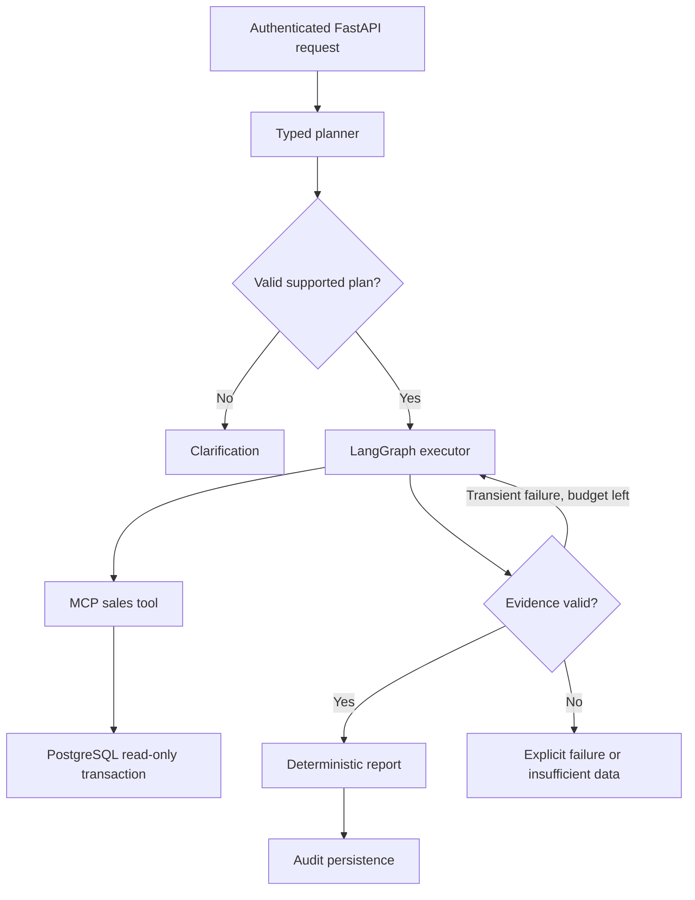

# Architecture and scope

## Business contract
Analyze completed sales in one currency (INR) from a curated dataset. Support
revenue totals, comparison with the immediately preceding equally long period,
and a product contribution breakdown. Dates are UTC calendar dates with an
inclusive start and exclusive end. Refunds, currency conversion, gross margin,
forecasting, arbitrary SQL, and causal inference are out of scope in v0.1.
A sale is one order row; revenue is stored as integer paise, never floating point.
The ingestion owner supplies coverage intervals: zero sales inside known coverage
is zero revenue; absence of coverage is insufficient data, not zero revenue.

## Request path

Redis caches evidence by tenant, data revision, dates and operation with a TTL.
The data revision is a deployment/ingestion contract; increment after every import.
No natural-language question or API secret enters cache keys or log records.
PostgreSQL persists completed response snapshots; it is not a LangGraph checkpointer.
Requests are synchronous, deadline-bounded, and do not resume after a process crash.

## Decisions and tradeoffs
- A constrained semantic plan is the model output. The compiler owns SQL syntax,
  columns, table names, filters and grouping. This limits supported questions but
  makes tool arguments and SQL safety independently testable.
- LangGraph owns explicit planning, execution/retry, validation and reporting nodes.
  This is a bounded agentic workflow, not an autonomous general-purpose analyst.
- MCP v1 is intentionally pinned below v2 to use the tested stdio SDK API.
  A child tool process is started per analysis/cache miss. It receives only the
  read-only warehouse DSN and authenticated tenant. No model key or audit DSN is
  passed. Stdio is local to the container and has no publicly exposed MCP port.
  Process startup has a latency cost; a pooled authenticated remote transport is
  a future scaling decision, not a claimed feature.
- Tenant identity comes from a server-side API-key mapping, never request or model
  arguments. SQL filters plus PostgreSQL forced RLS provide defense in depth.
  Each tool transaction sets the tenant. The read role is not an owner/superuser
  and cannot bypass RLS. Audit access has separate credentials and RLS.
- Financial totals use integer minor units. Percentages use Decimal with explicit
  rounding; change from a zero baseline is undefined, not infinity.
- Reports cite query template, bounded parameters, dataset revision, and evidence
  hash. Product changes describe contributions; they do not establish causes.
- Production requires PostgreSQL and Redis. SQLite and an in-process TTL cache
  are development conveniences only. Redis failure bypasses caching; audit failure
  fails the request so a success is never returned without its audit record.
- ECS Fargate is the AWS deployment target: no Kubernetes control plane is needed
  for this initial API plus local MCP process. Use private RDS and ElastiCache,
  Secrets Manager, ALB TLS, CloudWatch logs and an optional OTLP collector.
- External model calls are disabled by default. An explicit configuration flag
  and key are both required. No paid/model calls are made by tests.

## Acceptance criteria (targets, not claims)
| ID | Gate | Verification |
|---|---|---|
| A1 | Exact totals, deltas and product contributions for seeded fixtures | Numeric assertions and evaluation cases |
| A2 | Tenant A cannot access tenant B data or saved reports | API tests and PostgreSQL RLS integration |
| A3 | Unknown plan fields/metrics, oversized ranges and raw SQL never execute | Schema and adversarial tests |
| A4 | At most two tool attempts, no retries for invalid input, request deadline | Failure-injection tests |
| A5 | Missing coverage yields insufficient_data; zero baseline has null percent | Fixture tests |
| A6 | Every successful API response is persisted and retrievable by its tenant | API and database tests |
| A7 | MCP handshake/discovery/call are exercised through a real child process | End-to-end test |
| A8 | Redis cache separates tenants, expires and bypasses on outage | Cache and integration tests |
| A9 | Auth required, logs omit question/key/data, metric labels remain bounded | API/observability tests |
| A10 | Offline evaluation correctness 100% on the checked-in limited suite | Evaluation command with nonzero failure exit |
| A11 | CI lint, tests, evaluation, PostgreSQL integration and image build pass | CI configuration; hosted run needs separate evidence |
| A12 | On agreed staging hardware: p95 uncached <10s at 5 concurrent users, error rate <1% | Future load test; not a measured SLA |
| A13 | Live-model supported-plan accuracy >=95%, unsafe execution 0 on >=100 held-out cases | Future approved provider evaluation |

## Milestones
1. Contract, architecture, fixture and acceptance criteria.
2. Typed planning, safe compiler, LangGraph orchestration and MCP.
3. Authenticated API, audit storage, caching, telemetry and failure handling.
4. Unit/security/integration tests and reproducible offline evaluation.
5. Docker, approval-gated CI/CD, AWS templates and operational documentation.
